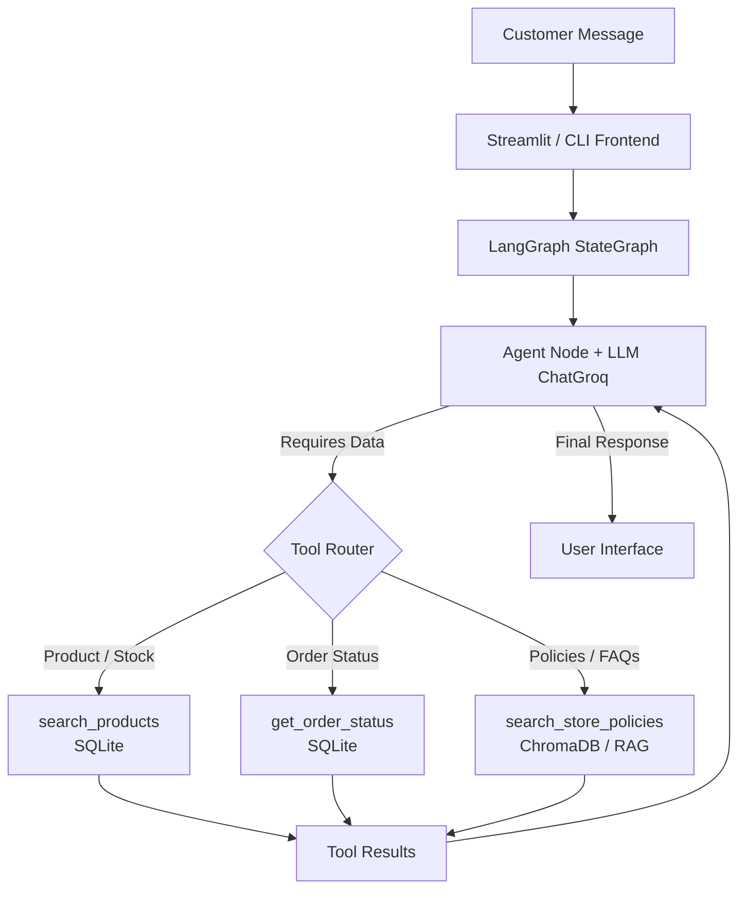

# 🎸 Empório da Música — AI Customer Service Agent

An intelligent, full-stack AI customer service agent built for **Empório da Música**, a fictional Brazilian musical instrument store, as part of the AI Engineer technical assessment for **Artefact**.

---

## 📋 Project Overview

Modern customer support requires instant access to structured operational data (products, prices, inventory, orders) and unstructured policy documentation (returns, exchanges, shipping, store hours). This project implements an autonomous conversational agent that seamlessly bridges both worlds using a hybrid architecture combining **LangGraph**, **SQLite**, and **ChromaDB (RAG)**.

The agent embodies a friendly, professional store persona, adheres to strict boundaries (e.g., selling musical instruments only, never inventing prices or order statuses), maintains conversational context across turns, and dynamically invokes tools when external data is required.

---

## ✨ Features

- **Product & Inventory Lookup**: Query active musical instruments by category, name, or maximum price threshold with automated category pluralization mapping.
- **Order Status Tracking**: Secure order status retrieval requiring both order ID and customer email verification.
- **Store Policy RAG**: Semantic retrieval of store policies (returns, exchanges, payments, shipping, opening hours) from policy documents using vector search.
- **LangGraph Orchestration**: Explicit state graph management with conditional tool routing, system prompt injection, and robust execution flow.
- **Conversation Memory**: Thread-isolated session history management using LangGraph checkpointers (`InMemorySaver`).
- **Interactive Streamlit Interface**: Clean, responsive web chat interface supporting session reset, chat history rendering, and real-time status indicators.
- **CLI Interface**: Terminal-based chat interface for headless testing and interaction.
- **Out-of-Scope Handling**: Graceful handling of unrelated inquiries (e.g., smartphones, non-musical items) while maintaining store persona.

---

## 🛠️ Tech Stack

| Technology | Responsibility |
| :--- | :--- |
| **Python 3.10+** | Core programming language |
| **LangGraph / LangChain** | Agent orchestration, state management, and tool binding |
| **Groq API / ChatGroq** | Large Language Model provider and inference (`openai/gpt-oss-20b`) |
| **SQLite & Pandas** | Structured operational data storage (products, orders, customers) and CSV seeding |
| **ChromaDB** | Vector database for semantic store policy search |
| **HuggingFace Embeddings** | Multilingual sentence embeddings (`sentence-transformers/paraphrase-multilingual-MiniLM-L12-v2`) |
| **PyMuPDF (`pymupdf`)** | PDF text extraction for store policies |
| **Streamlit** | Web-based conversational frontend |
| **python-dotenv** | Environment variable management |

---

## 🏛️ Architecture & Execution Flow

The system follows a reactive agentic loop managed by LangGraph:

1. **User Input**: The customer sends a message via the Streamlit web UI or CLI.
2. **State Management**: LangGraph loads the conversation history for the current session `thread_id`.
3. **Agent Reasoning**: The agent node combines the `SYSTEM_PROMPT`, conversation history, and user message, then invokes the LLM (`ChatGroq`).
4. **Tool Decision**: The LLM determines whether a tool (`search_products`, `get_order_status`, `search_store_policies`) is required.
   - If **Yes**, `tools_condition` routes execution to the `ToolNode`, which queries SQLite or ChromaDB.
   - Tool execution results are returned to the agent state.
5. **Response Generation**: The LLM synthesizes the retrieved data into a polite, natural response adhering to store guidelines.
6. **Persistence**: Conversation state is checkpointed in memory, and the response is rendered to the user.

### Mermaid Flowchart



---

## 📂 Project Structure

```text
artefact-ai-agent/
├── data/
│   ├── categories.csv      # Product categories data
│   ├── customers.csv       # Customer records
│   ├── order_items.csv     # Order line items
│   ├── orders.csv          # Order transactions & tracking
│   ├── products.csv        # Musical instrument catalog
│   ├── promotions.csv      # Active promotions & discounts
│   └── politicas.pdf       # Store policies document (RAG source)
├── src/
│   ├── agent/
│   │   ├── graph.py        # LangGraph agent definition & compilation
│   │   └── prompts.py      # System prompt & store persona definitions
│   ├── database/
│   │   ├── db.py           # SQLite connection utility
│   │   └── seed.py         # CSV-to-SQLite database seeding script
│   ├── rag/
│   │   ├── ingest.py       # PDF extraction & ChromaDB vector embedding
│   │   └── search.py       # Semantic vector search utility
│   ├── tools/
│   │   ├── order_tools.py  # Order lookup tool (SQLite)
│   │   ├── policy_tools.py # Policy search tool (ChromaDB)
│   │   └── product_tools.py# Product search & filter tool (SQLite)
│   ├── tests/
│   │   └── test_tools.py   # Manual verification script for tools
│   └── main.py             # CLI chat interface
├── .env                    # Environment variables (API keys)
├── .env.example            # Environment variables template
├── requirements.txt        # Project dependencies
└── streamlit_app.py        # Streamlit web application frontend
```

---

## 🧠 Agent Design and Technical Decisions

### Why LangGraph?
- **Explicit Orchestration**: Unlike black-box frameworks, LangGraph provides explicit control over agent execution loops, conditional routing (`tools_condition`), and state transitions.
- **State Management**: Native support for message history and checkpointing allows clean isolation of multi-turn conversations per user session (`thread_id`).
- **Simplicity**: Avoids over-engineered multi-agent swarms in favor of a robust single-agent graph architecture.

### Why SQLite?
- **Operational Data Fit**: Relational data (products, categories, customers, orders) is best queried with exact SQL filters (price ranges, stock quantities, email matching).
- **Zero Configuration**: Lightweight, self-contained file-based database that requires no external database server, ensuring effortless local reproducibility.

### Why ChromaDB & RAG?
- **Semantic Flexibility**: Store policies (returns, warranties, shipping rules) are unstructured text documents where semantic search (`k=5` similarity search) outperforms keyword matching.
- **Separation of Concerns**: Keeps dynamic operational data in SQLite while static institutional knowledge resides in vector embeddings.

### Why Hybrid Retrieval?
- Combining SQL queries for operational facts and vector search for policies allows the agent to answer complex multi-faceted queries (e.g., *"Do you have acoustic guitars under R$ 1500 and what is your return policy?"*) by invoking both toolsets in parallel or sequence.

### Why Streamlit?
- Enables rapid prototyping and deployment of a fully functional conversational UI with zero frontend boilerplate.

---

## 📚 RAG Pipeline

1. **Extraction**: `src/rag/ingest.py` reads `data/politicas.pdf` using PyMuPDF (`pymupdf`), extracting text page by page while discarding empty pages.
2. **Chunking**: Text is split into manageable chunks using `RecursiveCharacterTextSplitter` with `chunk_size=1000` and `chunk_overlap=200` to preserve context boundaries across paragraphs.
3. **Embeddings**: Utilizes HuggingFace's multilingual sentence transformer model:
   `sentence-transformers/paraphrase-multilingual-MiniLM-L12-v2`
4. **Vector Storage**: Embeddings are stored persistently in the local `chroma_db/` directory under the collection name `store_policies`.
5. **Retrieval**: `src/rag/search.py` performs similarity search (`k=5`) returning relevant policy excerpts to the `search_store_policies` tool.

---

## 🧰 Tools Reference

| Tool Name | Purpose | Data Source | Example Customer Request |
| :--- | :--- | :--- | :--- |
| `search_products` | Search instruments by name, category, or max price | SQLite (`products`, `categories`) | *"Vocês têm violões até R$ 1000?"* |
| `get_order_status` | Retrieve order status, delivery date, and tracking code | SQLite (`orders`, `customers`) | *"Qual o status do meu pedido #1023?"* |
| `search_store_policies` | Answer questions about returns, exchanges, shipping, and store hours | ChromaDB (`store_policies`) | *"Qual é a política de devolução para compras online?"* |

---

## 💾 Conversation Memory

- Implemented using LangGraph's `InMemorySaver` checkpointer.
- Each Streamlit session generates a unique UUID `thread_id`, isolating conversation history per tab/user.
- Sidebar button allows users to start a "Nova conversa" (New conversation), clearing the message history and generating a new `thread_id`.

---

## ⚙️ Installation and Setup

### 1. Prerequisites
- Python 3.10 or higher installed on your system.
- A valid Groq API key (`GROQ_API_KEY`).

### 2. Clone the Repository
```bash
git clone https://github.com/your-username/artefact-ai-agent.git
cd artefact-ai-agent
```

### 3. Create a Virtual Environment
- **Windows (PowerShell):**
  ```powershell
  python -m venv .venv
  .\.venv\Scripts\Activate.ps1
  ```
- **Linux / macOS:**
  ```bash
  python3 -m venv .venv
  source .venv/bin/activate
  ```

### 4. Install Dependencies
```bash
pip install --upgrade pip
pip install -r requirements.txt
```

### 5. Configure Environment Variables
Create a `.env` file in the project root based on `.env.example`:
```env
GROQ_API_KEY=your_groq_api_key_here
```

### 6. Initialize SQLite Database
Seed the operational database with sample CSV data:
```bash
python -m src.database.seed
```

### 7. Run RAG Ingestion (Vector Database)
Process the store policy PDF and build the ChromaDB vector store:
```bash
python -m src.rag.ingest
```

### 8. Run the Streamlit Web Interface
```bash
streamlit run streamlit_app.py
```
Open your browser at `http://localhost:8501`.

### 9. (Optional) Run the CLI Interface
```bash
python -m src.main
```

---

## 💬 Usage Examples

### Example 1: Product Search with Budget Constraint
- **User**: *"Olá! Vocês vendem violões acústicos até R$ 1500?"*
- **Agent Action**: Invokes `search_products(query="violão", max_price=1500)`
- **Agent Response**: Lists available models matching the criteria with prices and stock status.

### Example 2: Store Policy Inquiry (RAG)
- **User**: *"Qual é o prazo para troca de um produto com defeito?"*
- **Agent Action**: Invokes `search_store_policies(question="prazo troca produto defeito")`
- **Agent Response**: Cites the correct return and exchange policy retrieved from `politicas.pdf`.

### Example 3: Order Status Check
- **User**: *"Gostaria de saber o status do pedido 102. Meu e-mail é cliente@exemplo.com"*
- **Agent Action**: Invokes `get_order_status(order_id=102, email="cliente@exemplo.com")`
- **Agent Response**: Returns delivery estimation and tracking code.

### Example 4: Out-of-Scope Handling
- **User**: *"Vocês consertam smartphones ou vendem capinhas?"*
- **Agent Action**: Evaluates query against system prompt rules.
- **Agent Response**: Politely explains that Empório da Música specializes exclusively in musical instruments and does not provide smartphone repair or accessories.

---

## 🧪 Testing and Validation

- **Manual Tool Testing**: You can verify core tools independently by running:
  ```bash
  python -m src.tests.test_tools
  ```
  This script executes test calls against `search_products`, `get_order_status`, and `search_store_policies`, printing results directly to the console.

---

## ⚠️ Known Limitations

- **Ephemeral Memory**: The default `InMemorySaver` stores conversation state in memory; restarting the application resets session history.
- **Local SQLite & ChromaDB**: Designed for local execution and assessment demonstration; production scaling would require a robust SQL database (e.g., PostgreSQL) and managed vector store.
- **Customer Authentication**: Order status verification relies solely on email and order ID matching without multi-factor authentication (OTP).
- **External Dependencies**: Relies on Groq API availability and rate limits.

---

## 🚀 Future Improvements

- **Persistent Checkpointing**: Integrate PostgreSQL or Redis checkpointer for durable multi-session persistence.
- **Automated Evaluations**: Add RAGAS or LangSmith evaluation datasets to measure retrieval precision and faithfulness.
- **Enhanced Authentication**: Implement JWT or OAuth-based customer authentication in the UI.
- **Omnichannel Integration**: Extend the LangGraph agent to WhatsApp Business API or WebSockets for real-time chat.

---

## 🤖 AI-Assisted Development Disclosure

In accordance with modern AI engineering practices, generative AI coding assistants (such as ChatGPT and Claude) were utilized during the development of this project for architectural brainstorming, syntax guidance, boilerplate code generation, and documentation drafting. All system logic, prompt design, tool integrations, and final code structures were rigorously reviewed, tested, and validated by the candidate to ensure technical accuracy and alignment with Artefact's assessment requirements.
